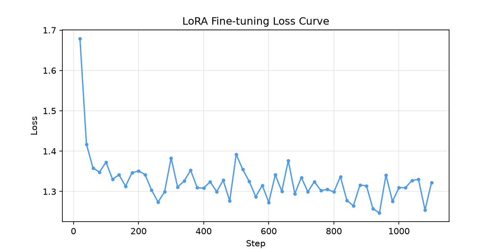

# LoRA 中文问答助手（Qwen2-7B + LoRA 轻量化微调 + LangGraph Agent）

> 用 LoRA 对 Qwen2-7B-Instruct 做指令微调，目标是让回答更简洁、术语更准确。
> 只训练 0.5% 的参数，单卡 12GB 显存就能跑完训练；在此基础上用 LangGraph 加了一层
> ReAct 推理与工具调用，并用 vLLM 把微调后的模型部署成 OpenAI 兼容接口。
>
> 数据、训练、评估、推理四步都有对应脚本，按下面的顺序跑一遍就能复现这里的所有结果。


---

## 基本信息

| 项目 | 说明 |
|---|---|
| 基座 / 方法 | Qwen2-7B-Instruct + LoRA（r=8, α=16, dropout=0.05），注入注意力与 FFN 共 7 个线性层 |
| 可训练参数 | 约 3,700 万，占全量 0.5% |
| 显存 | 4bit NF4 量化 + 双重量化 + 梯度检查点 + 8bit paged AdamW，训练占用约 12GB |
| 训练规模 | 1 epoch / 1,116 步 |
| 数据 | alpaca_zh_51k 采样 2 万条，清洗后 18,053 条，训练 17,853 / 评估 200 |
| Agent | LangGraph ReAct 状态机、3 类工具、多轮记忆 |
| 部署 | vLLM 部署为 OpenAI 兼容 API，LangChain 接入 |

### 消融实验：区分 prompt 与微调的作用

[`ablation.py`](ablation.py) 用 4 组对照把 system prompt 和 LoRA 的作用分开：

| 组合 | 配置 | 作用 |
|---|---|---|
| A | 原始模型（无 prompt） | 基线 |
| B | 原始模型 + system prompt | 看 prompt 单独能带来什么 |
| C | LoRA 微调模型（无 prompt） | 看微调单独能带来什么 |
| D | LoRA 微调模型 + system prompt | 两者叠加 |

四组结果都写到 `output/ablation.md`，可以逐题对照。写这个脚本的起因是：
只跑微调前后的对比，没法说明提升是来自参数更新还是来自那句 system prompt。

---

## 🤖 Agent 升级版（LangGraph + ReAct + 工具调用）

在微调模型之上加一层 Agent：支持 ReAct 推理（Thought → Action → Observation 循环）与工具调用（数学计算 / 时间查询 / 网页查证）。

```
┌─ 应用层：Gradio Agent 界面（ReAct 轨迹可视化）──────────────────┐
│                                                               │
├─ Agent 层：                                                    │
│   • LangGraph 手写 ReAct 状态机（模型节点 → 工具节点 → 循环）    │
│   • Prompt 模式工具协议：模型输出 JSON Action，代码解析并执行    │
│   • 工具集：calculator / get_current_time / fetch_url           │
│   • MemorySaver 多轮对话记忆 + 对话指代问题直查历史兜底          │
│                                                               │
├─ 模型服务层：vLLM 部署微调模型为 OpenAI 兼容 API（ChatOpenAI）   │
│   • Qwen2-7B-Instruct + LoRA adapter（output/lora-qwen2/final）│
│                                                               │
└─ 数据底座：alpaca_zh_51k 2万条 → 清洗 18053 条 → LoRA 微调       │
```

**Agent 相关文件**：

| 文件 | 作用 |
|---|---|
| [`agent/tools.py`](agent/tools.py) | 工具集（安全 AST 计算器 / 时间 / 网页抓取），全部真实可用、无需外部 API Key |
| [`agent/llm.py`](agent/llm.py) | LLM 后端工厂（默认对接本机 vLLM，可用环境变量切换后端与模型名） |
| [`agent/agent_react.py`](agent/agent_react.py) | LangGraph ReAct Agent（手写 StateGraph + 多轮记忆 + 工具协议解析） |
| [`agent/gradio_agent.py`](agent/gradio_agent.py) | Gradio Agent 网页界面（Thought/Action/Observation 可视化） |
| [`agent/agent_deep.py`](agent/agent_deep.py) | DeepAgents 主代理（主代理 + 子代理委派 + 文件工具；需 vLLM 新版本支持原生工具调用，当前 vLLM 0.8.5 下受限） |
| [`agent/serve_vllm.sh`](agent/serve_vllm.sh) | AutoDL 一键部署脚本（vLLM + LoRA → OpenAI 兼容 API） |
| [`agent/requirements-agent.txt`](agent/requirements-agent.txt) | Agent 依赖清单 |

**设计要点**：

- **为什么用 Prompt 模式而非模型原生 tool calling**：部署环境的 vLLM 0.8.5 不提供 Qwen 的原生工具调用解析器（`--tool-call-parser qwen` 直接报错）。为了不换版本、不降模型，改用经典 ReAct Prompt 模式——把工具 JSON Schema 写进系统提示词，模型输出一行 JSON Action，代码解析并执行。好处是不依赖模型原生能力、对 7B 模型的输出格式更可控。
- **工具协议容错**：用三层正则（内嵌 JSON / 代码块包裹 / 首个大括号块）解析模型输出，解析失败即降级为直接回答，避免流程卡死；`MAX_STEPS=8` 防止无效循环。
- **工具安全**：计算器用 AST 白名单求值，只放行数字常量和四则、幂、取模这类运算符，函数调用、变量、属性访问在语法树层面就会被拒绝，所以不存在 `eval()` 那种代码注入问题。
- **指代问题兜底**："上一个问题是什么"这类对话指代先走规则解析直查历史，**不消耗模型推理**；规则解析不出但疑似在问历史时，走"禁工具"回合让模型基于历史回答——既防误调工具，又降低无效推理开销。

---

## 运行结果

### 1. 数据长度分布

`1_data_preprocess.py` 会打印长度统计并输出分布图（`data/length_distribution.png`）。清洗后 17,853 条训练样本的实测分布：

| 统计量 | instruction（字符） | output（字符） | 套完 chat 模板后（估算 token） |
|---|---|---|---|
| 均值 | 18.3 | 93.3 | 124 |
| P50 | 16 | 74 | 106 |
| P95 | 32 | 241 | 248 |
| P99 | 52 | 401 | 371 |
| 最大 | 171 | 1019 | 843 |

据此把 `MAX_SEQ_LEN` 设为 1024：按估算，1024 token 下**没有样本会被截断**（设成 512 也只有 0.2% 会被截断），
留出的余量是给分词结果波动和后续更换数据集用的。

### 2. 训练损失曲线



1 epoch / 1,116 步，loss 由 1.68 降到约 1.32。前 80 步下降很快，之后基本在 1.30~1.38 之间波动，
末段没有回升，看上去 1 轮就收敛了。

### 3. 微调前后同题对比（6 组）

完整对比见 [`output/comparison.md`](output/comparison.md)，下面摘两个例子。

**案例一 · 领域术语纠错**

> **Q：简单解释一下 LoRA 微调的原理。**
>
> - **原始模型**：*"LoRA（Long Range）微调是一种无线通信技术，其主要原理是通过扩频和调制技术来实现远距离通信……"*（完全错误）
> - **LoRA 微调后**：*"LoRA 微调是一种机器学习技术，它使用少量的数据来训练模型……"*（方向正确）

**案例二 · 回答冗余度**

> **Q：Python 中列表和元组的区别是什么？**
>
> - **原始模型**：分 3 大类（可变性 / 语法 / 性能）逐条展开，约 400+ 字
> - **LoRA 微调后**：*"列表是可变的，而元组是不可变的……此外，列表使用方括号，而元组使用圆括号。"* 约 60 字，
>   信息没丢，篇幅压缩了约 60%

### 4. 结果记录

| 指标 | 数值 |
|---|---|
| 训练 loss | 1.68 → 约 1.32（1 epoch / 1,116 步） |
| 可训练参数占比 | 约 0.5% |
| 清洗保留率 | 18,053 / 20,000 = 90.3% |
| Perplexity 对比 | 待补：跑 `python 3_evaluate.py` 后打印 |

> 关于 PPL 有两点要说明：一是 `3_evaluate.py` 里 `build_eval_texts(n=100)` 实际只取了
> 评估集**前 100 条**（评估集一共 200 条），且用的是单窗口截断式 PPL；二是这个指标受硬件和
> 随机种子影响，我这边没跑，所以不填数字。**自己跑一遍再把自己的结果写进来。**

---

## 📂 项目结构

```
lora-qa-chatbot/
├── config.py               # 全局配置（超参集中管理，含 HF 镜像兜底）
├── requirements.txt        # 训练/推理依赖清单
├── 1_data_preprocess.py    # 数据清洗 + 分布统计 + 可视化 + 划分
├── 2_train_lora.py         # 4bit 加载 → LoRA 注入 → 训练 → 保存
├── 3_evaluate.py           # PPL 对比 + 同题生成对比
├── 4_infer_demo.py         # 命令行本地问答 Demo（4bit 基座 + LoRA）
├── ablation.py             # 消融对比：system prompt × LoRA 微调（4 组对照）
├── gradio_demo.py          # 网页聊天 Demo（原始版，GPU 实例运行）
├── infer_local.py          # 本地 CPU 推理版（Qwen2-1.5B + LoRA，无显卡电脑用）
├── lora_qa_chatbot_modelscope.ipynb   # 魔搭平台训练笔记本（云端 GPU 训练用）
├── agent/                  # Agent 升级版（LangGraph + ReAct + 工具调用）
│   ├── tools.py            #   工具集（计算 / 时间 / 网页）
│   ├── llm.py              #   LLM 后端工厂（vLLM OpenAI 兼容接入）
│   ├── agent_react.py      #   LangGraph ReAct Agent（手写 StateGraph）
│   ├── agent_deep.py       #   DeepAgents 主代理（vLLM 0.8.5 下受限）
│   ├── gradio_agent.py     #   Gradio Agent 界面（ReAct 轨迹可视化）
│   ├── serve_vllm.sh       #   vLLM + LoRA 部署脚本
│   └── requirements-agent.txt
├── data/                   # （运行后生成）清洗后数据 + 分布图
├── output/                 # 训练产物：loss 曲线 / 同题对比
└── docs/                   # 项目文档（架构详解 / 流程图）
```

详细讲解见 [`docs/架构详解.md`](docs/架构详解.md)（零基础向，含模型架构、Agent 架构、每个文件职责）。

---

## ⚠️ 关于本仓库未包含的文件

为保持仓库轻量（并遵守 GitHub 单文件 25MB 限制），以下**可由脚本重新生成**的产物未纳入版本控制（见 [`.gitignore`](.gitignore)）：

| 未包含 | 体积 | 生成方式 |
|---|---|---|
| `data/train.jsonl`、`data/eval.jsonl` | ~6.5MB | 运行 `python 1_data_preprocess.py`，自动下载数据集并清洗生成 |
| `output/lora-qwen2/final/`（LoRA adapter） | ~80MB | 运行 `python 2_train_lora.py` 训练生成（adapter + tokenizer，约 15MB） |
| `models/`（Qwen2-7B 基座权重） | ~15GB | 由 `BASE_MODEL` 自动从 HuggingFace 下载，或从魔搭克隆 |

因此，**克隆本仓库后请按下方「快速开始」依次运行脚本**，即可完整复现全部结果。

---

## 🚀 快速开始

### 环境准备

```bash
# 建议 Python 3.10+
pip install -r requirements.txt

# Windows 用户注意：torch 需装 CUDA 版（已装可跳过）
pip install torch --index-url https://download.pytorch.org/whl/cu121
```

国内网络下载 HuggingFace 资源慢时，先设镜像（`config.py` 已自动兜底，也可手动设）：

```bash
# Windows PowerShell
$env:HF_ENDPOINT = "https://hf-mirror.com"
# macOS / Linux
export HF_ENDPOINT=https://hf-mirror.com
```

### 三步复现训练

```bash
python 1_data_preprocess.py   # ① 数据处理：下载→采样→清洗→分布图→train/eval
python 2_train_lora.py        # ② LoRA 微调：4bit 加载→训练→保存 adapter + loss 曲线
python 3_evaluate.py          # ③ 效果评估：PPL 对比 + 同题回答对比
python 4_infer_demo.py        # ④ （可选）本地问答 Demo
python ablation.py            # ⑤ （可选）4 组消融对比，输出 output/ablation.md
```

> 无本地 GPU 时，可用 [`lora_qa_chatbot_modelscope.ipynb`](lora_qa_chatbot_modelscope.ipynb) 在魔搭（ModelScope）云端 GPU 实例上训练，新用户有免费算力额度。

### 启动 Agent 版

```bash
# ① 部署微调模型为 OpenAI 兼容 API（vLLM 0.8.5 固定版本，兼容 CUDA 12.8 驱动）
bash agent/serve_vllm.sh

# ② 安装 agent 依赖并启动网页 Demo
pip install -r agent/requirements-agent.txt -i https://pypi.tuna.tsinghua.edu.cn/simple
python -m agent.gradio_agent    # 浏览器打开 http://127.0.0.1:7861

# ③ 或命令行直跑
python -m agent.agent_react "帮我算一下 (23+67)*45 等于多少？"
```

> 注意：`--served-model-name` 与 `--lora-modules` 的模块名不能同名（否则 vLLM 命中 base 模型、LoRA 不生效）；LoRA 模块名当前为 `lora1`，与 [`agent/llm.py`](agent/llm.py) 的 `LLM_MODEL` 默认值一致。

---

## 🧰 技术栈

| 模块 | 选型 | 说明 |
|---|---|---|
| 基座模型 | Qwen2-7B-Instruct | 阿里开源，工业界主流，无需申请权限 |
| 微调方式 | LoRA（低秩适配） | 参数高效微调，可训练参数 <1% |
| 量化 | 4bit（NF4 + 双量化） | 权重显存直降 ~70% |
| 框架 | Transformers / PEFT / Bitsandbytes | Trainer 原生流程，透明可控 |
| 数据集 | hfl/alpaca_zh_51k（采样 2 万条） | instruction/input/output 三字段，格式干净 |
| 评估 | Perplexity + 人工对比 + 消融实验 | 客观指标 + 主观效果 + 归因分析 |
| Agent | LangGraph / DeepAgents / Gradio | ReAct 推理循环 + 工具调用 + 轨迹可视化 |
| 部署 | vLLM（OpenAI 兼容 API） | 微调模型推理服务化 |

## ⚙️ 关键超参与默认值

| 超参 | 默认 | 说明 |
|---|---|---|
| LoRA Rank r | 8 | 秩控制参数量：r 越大表达能力越强但更易过拟合；8/16 是工业界最常用区间 |
| lora_alpha | 16 | 实际缩放 = alpha / r = 2；过大训练不稳，过小适配不足 |
| lora_dropout | 0.05 | 低秩矩阵 dropout，防过拟合 |
| target_modules | 7 个线性层 | q/k/v/o_proj + gate/up/down_proj（LLaMA 系结构通用） |
| learning_rate | 2e-4 | LoRA 只更新少量参数，学习率比全量微调（1e-5~5e-5）高一个量级 |
| num_train_epochs | 3 | 小数据集（2 万条）轮次过多必过拟合；实测 1 轮即收敛 |
| max_seq_len | 1024 | 单样本最大 token 数（可降到 768 应对小显存） |
| batch_size / grad_accum | 1 / 16 | 单卡小显存；等效 batch = 16，兼顾稳定与显存 |
| 4bit + NF4 + 双量化 | on | 权重 3.5GB 级占用，7B 模型单卡可训 |

---

## ❓ 常见报错速查

| 报错 | 原因 | 解决 |
|---|---|---|
| `CUDA out of memory` | 显存不够 | 降 `MAX_SEQ_LEN` 到 768 / 关 `DOUBLE_QUANT` / 换更大显存卡 |
| `bitsandbytes` 导入失败 | 缺 CUDA 对应 wheel | `pip install bitsandbytes --prefer-binary`，确认 torch 是 CUDA 版 |
| 训练报 `use_cache` 冲突 | 未关闭 cache | 训练脚本已处理；若自定义 Trainer 需手动 `model.config.use_cache=False` |
| vLLM 报 `driver too old (found 12080)` | vLLM 新版与 CUDA 12.8 驱动不兼容 | 固定安装 `vllm==0.8.5`（见 `serve_vllm.sh`） |
| vLLM 报 `invalid tool call parser: qwen` | vLLM 0.8.5 不支持 Qwen 原生工具调用 | Agent 使用 Prompt 模式 ReAct（`agent_react.py`），不依赖原生工具调用 |
| 模型答成"LoRa 无线通信"（微调前行为） | LoRA 未生效：served-name 与 lora 模块名同名 | LoRA 模块名改为独立名（`lora1`），`LLM_MODEL=lora1` |
| 下载慢 / 超时 | 网络问题 | 设置 `HF_ENDPOINT=https://hf-mirror.com` |

---

## 📖 数据集与基座说明

**`hfl/alpaca_zh_51k`**：哈工大讯飞联合实验室（HFL）在 [Chinese-LLaMA-Alpaca](https://github.com/ymcui/Chinese-LLaMA-Alpaca) 项目中开源的中文指令微调数据集，由 Stanford Alpaca 52k 翻译/改写而来，共约 5.1 万条，字段为 `instruction / input / output`。

实测的几点情况，以及处理方式：

| 情况 | 实测 | 处理方式 |
|---|---|---|
| `input` 字段大量为空 | 训练集 64.0% 为空 | 格式化时按需拼接，空值不参与拼接 |
| 回答偏冗长、markdown 分点堆砌 | output 均值 93 字符，最长 1019 | 用 system prompt + LoRA 把"简洁"写进监督信号，篇幅压缩约 60% |
| 超长样本 | instruction 最长 171、output 最长 1019 字符，均在阈值内，无样本被过滤 | 清洗阶段**直接过滤**而不是截断，避免留下"半截答案" |
| 完全重复的样本 | `instruction+input` 重复 1 组 | 未做去重（`clean_example` 是逐条过滤）；已确认训练集与评估集无交叉重叠 |
| 乱码 / 纯符号内容 | 清洗后 0 条 | 正则过滤已覆盖 |
| 通用通识数据，非垂直领域 | — | 本项目目标是风格对齐，不是知识注入；垂直知识场景应该用 RAG |

---

## 📄 许可与致谢

- 本仓库代码与文档采用 **MIT License**，详见 [`LICENSE`](LICENSE)。
- 基座模型 [Qwen/Qwen2-7B-Instruct](https://huggingface.co/Qwen/Qwen2-7B-Instruct) 遵循 **Apache License 2.0**。
- 数据集 [hfl/alpaca_zh_51k](https://huggingface.co/datasets/hfl/alpaca_zh_51k) 遵循 **Apache License 2.0**。
- 这是一个学习与练手项目，loss 曲线、同题对比、长度分布都来自实际运行；PPL 一栏没跑，所以留空。
